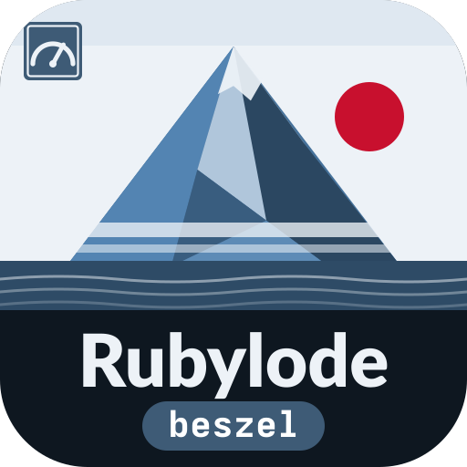
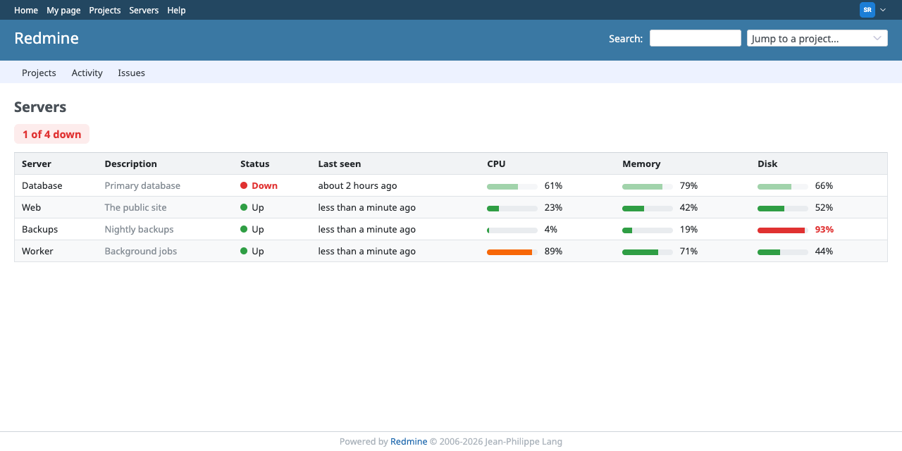
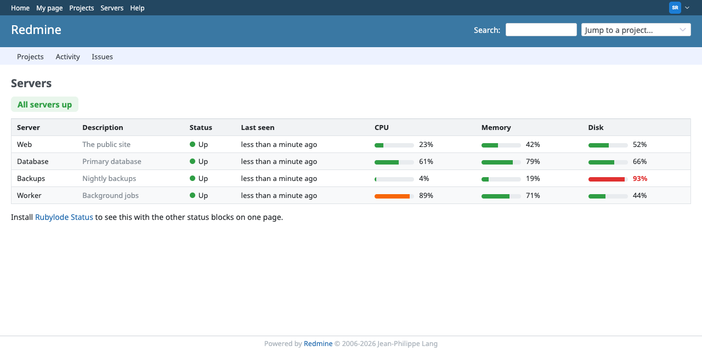
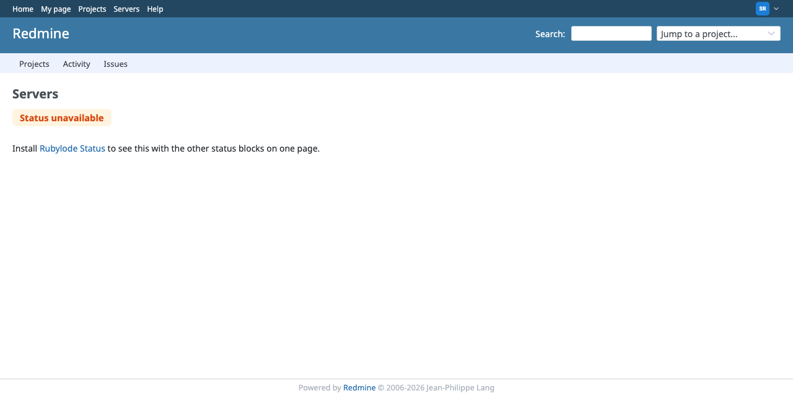
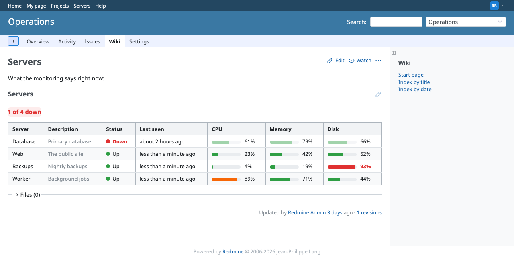
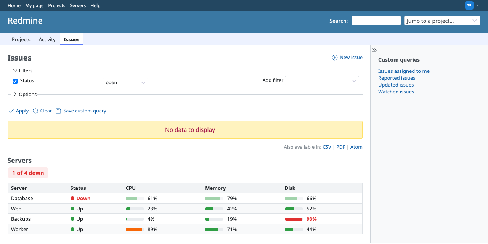

# Rubylode Beszel for Redmine

TL;DR: this plugin shows the latest status of the servers a [Beszel](https://beszel.dev) hub monitors inside
[Redmine](https://www.redmine.org): up or down, when each was last seen, and CPU, memory and disk usage as bars. It comes
as a wiki macro, a page, a My page block and a partial.

The hub's login stays in environment variables and the plugin only reads. Status: version 1.1.1, needs Redmine 5.1 or newer, tested
against a fake hub. `docs/roadmap/ROADMAP.md` lists what is not done.

Contents:

- [What it does](#what-it-does)
- [Installation](#installation)
- [Settings](#settings)
- [Security](#security)
- [Where it shows](#where-it-shows)
- [How to show the block on other pages](#how-to-show-the-block-on-other-pages)
- [Try it](#try-it)
- [Restyling it](#restyling-it)
- [Troubleshooting](#troubleshooting)
- [Tests](#tests)
- [License](#license)

## What it does

Asks your Beszel hub which systems it monitors and shows them in a table: name, description, status (up, down, paused),
how long ago the hub last heard from the server, and bars for CPU, memory and disk. A bar turns amber from 80 percent and
red from 90, so a nearly full disk stands out. Down servers come first. A summary line says "All servers up" or "2 of 5 down".

If the hub cannot be reached the block says "Status unavailable" (administrators also see why) and the page around it still
renders. The hub's answer is cached (60 seconds by default, 30 after a failure), so a busy Redmine does not hammer it.

| All up, one disk nearly full | Hub unavailable |
|---|---|
|  |  |

All screenshots show the made-up data of the fake hub in `test/support/fake_beszel_hub.rb`.

## Installation

Redmine 5.1 or newer, and a Beszel hub (a PocketBase app) that Redmine can reach. The plugin adds no table. The folder must be
named `redmine_rubylode_beszel`, the same as the plugin id.

1. Put the plugin in your Redmine's `plugins` folder:

       cd /path/to/redmine/plugins
       git clone https://github.com/rubylode/redmine-rubylode-beszel.git redmine_rubylode_beszel

2. In Beszel, make a user for Redmine (a regular user is enough, it only reads). Put its email and password in two
   environment variables of the process that runs Redmine, for example `BESZEL_EMAIL` and `BESZEL_PASSWORD`.

3. Restart Redmine ([Passenger](https://www.phusionpassenger.com), [Puma](https://puma.io), whatever serves it).

4. Open Administration, Plugins, Rubylode Beszel, Configure, and enter the hub URL.

To upgrade, `git pull` and restart. To remove it, delete the folder and restart; the settings stay in the database as one
`plugin_redmine_rubylode_beszel` row, which you can delete.

## Settings

| Setting | Meaning |
|---|---|
| Beszel hub URL | For example `https://beszel.example.com`. Empty: the block shows nothing, except a hint to administrators. |
| Email / password environment variables | The NAMES of the variables that hold the credentials. They must start with `BESZEL_` (defaults `BESZEL_EMAIL`, `BESZEL_PASSWORD`). The settings page tells you whether each is set. |
| Allow plain http | Off by default. See [Security](#security). |
| Other allowed hosts | Hosts a redirect from the hub may lead to. Normally empty. |
| Servers | Optional, one per line: `Name | system name in Beszel | Description`. The Beszel name and the description may be empty (an empty Beszel name means the same as the name). Lines starting with `#` are skipped. Leave the box empty to show every system the hub has. |
| Cache seconds, failure cache seconds, timeout seconds | 60, 30 and 2. |
| Show the block on | Checkboxes for the welcome page (left or right column), My page, the project Overview page (left or right column), a link in the top menu, and a list of path patterns. See below. |
| Block title | Shown above the block (default "Servers"). |
| Who may see it | Everyone who is signed in (default), or administrators only. Anonymous visitors never see it. |

Example servers list:

    Web | web-1 | The public site
    Database | db-1 | Primary database
    Backups | backup-1 |

## Security

The hub's email and password are never saved in Redmine's database, never shown on a page, never written to the log and never
part of an error message (errors name the problem, not the credential). They are read from environment variables when a
request is made.

- Only `BESZEL_...` variables are read. The settings accept a variable name only if it matches `BESZEL_[A-Z0-9_]*`, and
  the check is made again every time the credentials are read. A name like `SECRET_KEY_BASE` or `DATABASE_PASSWORD` is
  refused when you save the settings, and if it is somehow in the database anyway it is ignored: the credential counts as
  missing and nothing is sent. Otherwise an administrator could point the plugin at one of Redmine's own secrets and a
  hub URL of their choosing.
- The credentials go to one host. They are sent only to the host of the saved hub URL. A redirect is followed only to that
  host or to a host listed under "Other allowed hosts", at most three times; a redirect anywhere else stops the request
  before the credentials are sent again, and the block says "Status unavailable".
- https is required, unless the host is loopback. A hub URL that starts with `http://` is refused when you save it, and the
  credentials are not sent at runtime, unless the host is `localhost`, `127.0.0.1` or `::1`, or you tick "Allow plain http".
  Tick it only when the hub is on a network you trust (Docker's internal network, a private LAN), because anyone who can
  watch that traffic can read the password.
- The plugin asks the hub only for the fields it shows (name, status, last update, and the three usage numbers), so a server's
  address never leaves the hub.
- Give Redmine its own Beszel user, so you can revoke it without touching anyone else's login.

## Where it shows

- Wiki macro: `{{beszel_status}}`, or `{{beszel_status(title=Our servers)}}`. People who may not see it get nothing where it
  stands.
- Page: `/beszel_status`.
- My page block: "Server status" in the list of blocks you can add to My page.
- Partial, for other plugins and themes: `render partial: "rubylode_beszel/status"` (locals `title` and `show_title`).

## How to show the block on other pages

The same block, with the same permission setting and the same cache, can be put in many places. The settings page carries
this table and these snippets too.

| Where | How | Needs a setting |
|---|---|---|
| Wiki pages | the macro `{{beszel_status}}` | no |
| News, issue descriptions and comments | the macro | no |
| Project descriptions (so the project's Overview page) | the macro | no |
| The welcome text (Administration, Settings, General) | the macro | no |
| My page, as a block you can move | pick "Server status" in the Add list | no |
| Welcome page, left or right column | tick the box | Welcome page |
| My page, a small version at the top | tick the box | My page |
| Project Overview page, left or right column | tick the box | Project Overview page |
| Any other page, such as the issue list | list its path | Pages matching these paths |
| Its own page | open `/beszel_status` | no |
| The top menu | tick the box | Top menu link |
| A theme or another plugin | render the partial | no |

### The macro

It works in anything Redmine formats with its wiki syntax. The welcome text is one of those: Redmine 7.0.2's
welcome page view renders it with `textilizable`, the same helper that renders wiki pages, news, project and issue
descriptions and comments.

    {{beszel_status}}
    {{beszel_status(title=Our servers)}}

### The path list

It takes one pattern per line, drawn as a small version of the block at the top of each matching page:

    /issues
    /projects/*/issues
    /wiki*

`*` stands for any text, slashes included. A query string (`?status_id=o`) and a trailing `/` are ignored, so `/issues`
matches `/issues?set_filter=1`. A pattern must start with `/` and be at most 200 characters, with no `http://` or host
name; the settings page refuses anything else and names the line. Pages under `/admin`, `/settings`, `/login`, `/logout`
and `/account` never match a wildcard such as `/*`; to put the block there anyway, list a pattern that itself starts with
that prefix (`/admin/*`). A page that already shows the block (the macro, the page itself, the My page block) is not given
a second one.

### The partial

For a theme or another plugin's view. It draws nothing for people who may not see the block:

    <%= render partial: "rubylode_beszel/status" %>
    <%= render partial: "rubylode_beszel/status", locals: { compact: true, title: "Servers", show_title: false } %>

Locals, all optional: `title` replaces the block title, `show_title: false` hides it, `compact: true` gives the small variant
without the description and last seen columns.

### The standalone page

The page is `/beszel_status`. Link to it from any wiki text with `"Servers":/beszel_status`. Tick "Top
menu link" to get it in Redmine's top menu, named like the block title and shown only to the people allowed to see the
block (a plugin adds a top menu item with `menu :top_menu` in its `init.rb`, which is what the plugin does; the box decides
whether the item shows).

## Try it

A throwaway Redmine 7 and a fake Beszel hub run from this folder, with the repository mounted as the plugin:

    ruby bin/demo up                 start both and load the demo data; Redmine is on http://localhost:3013
    ruby bin/demo scenario one_down  make the fake hub report one server down (all_up, one_down, unavailable)
    ruby bin/demo restart            pick up a change to the plugin (it runs in production mode)
    ruby bin/demo down               stop it, keep the data
    ruby bin/demo reset              stop it and wipe the data

Placements are switched on for the welcome page, the project Overview page, `/issues` and the top menu. Sign in as admin / admin, or as `sam.rivera` with the password `demo-password-1`. The fake hub is at http://localhost:9113
and accepts the made-up credentials in `docker-compose.yml`. The wiki page is Operations, Servers. The data is throwaway;
never point the seed script at a real tracker.

`npm install && npm run screenshots` retakes the screenshots in `docs/screenshots` from the running demo.

## Restyling it

Every colour, size and gap is a CSS custom property on `.rubylode-beszel` (`--rubylode-beszel-up-color`,
`--rubylode-beszel-down-color`, `--rubylode-beszel-warning-color`, `--rubylode-beszel-bar-width` and so on, listed at the top
of `assets/stylesheets/rubylode_beszel.css`). A theme restyles the block by setting them; the defaults follow Redmine 7's own
palette and switch to dark colours with the system's dark mode. There is no JavaScript of its own.

## Troubleshooting

If the cache store cannot be read or written (a cache file owned by another user, a full disk), the plugin logs a warning with the error class and message, treats the cache as empty and fetches live. The page still renders.

## Tests

    bin/test                                         all unit and integration tests
    bin/test test/unit/system_status_test.rb         one file

They run in a Redmine 7 image with its test gems (`docker/test.Dockerfile`) against the fake hub in
`test/support/fake_beszel_hub.rb`, a small Ruby script that answers the two calls the plugin makes with the JSON shapes
PocketBase uses. It can run on its own: `FAKE_BESZEL_EMAIL=a@example.com FAKE_BESZEL_PASSWORD=x ruby test/support/fake_beszel_hub.rb`.

Pull Requests are welcome!

## Releasing

Push a `vX.Y.Z` tag whose version matches `version` in `init.rb` and has an entry in `CHANGELOG.md`. CI runs the tests, builds `redmine_rubylode_beszel-X.Y.Z.zip` and publishes the GitHub release with the changelog entry as its notes. To build a release for a tag that already exists, use Actions, release, Run workflow.

The text to paste when listing the plugin on www.redmine.org, and how to read the result of Check for updates, is in [docs/redmine-org-listing.md](docs/redmine-org-listing.md).

## License

GNU General Public License, version 2 or (at your option) any later version, the same as Redmine. See `LICENSE`.

Copyright (C) 2026  Nick Gorbikoff

No warranty, as the GPL says. The plugin only reads from your hub, but it holds a login for it, so read the Security section and try it on a copy of your tracker first. I tested it in CI with the Rubylode plugins' own test suites on Redmine 7.0, 6.1, 6.0 and 5.1, against a fake hub that follows the PocketBase API and Beszel's documented fields, not against every Beszel release.
